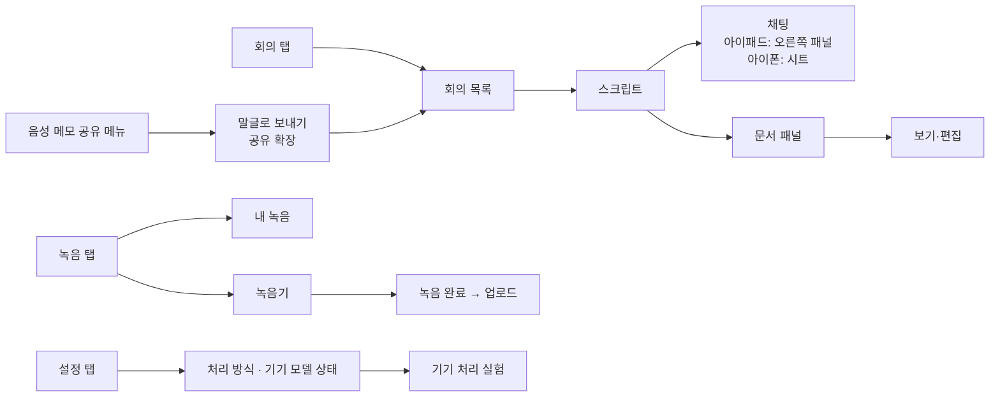

# 📝 말글 iOS


회의 녹음을 글로 바꿔 주는 서비스 **말글**(말 → 글)의 iPhone·iPad 앱입니다. 웹에서 하던 일을 모두 앱에서 할 수 있고, 앱 안에서 바로 녹음해 올릴 수 있습니다.

> [!NOTE]
> 이 저장소에는 앱 코드만 있습니다. 서버 주소와 앱 토큰은 코드에 없으며, 설정 화면이나 `malgeul://setup?server=…&token=…` 링크로 기기에 입력합니다(토큰은 키체인 저장).

---

## ✨ 기능

| 구분 | 내용 |
|------|------|
| 🎙️ 녹음 | 앱에서 바로 녹음(AAC 모노 24kHz), 일시정지·이어서, 화면이 꺼져도 계속 녹음, 전화 등 끼어들기 후 자동 이어 녹음, 실시간 파형 |
| ⬆️ 업로드 | 녹음 끝 → 제목 입력 → 업로드(녹음 시작 시각을 녹음 시각으로 저장), 선택 시 압축이 끝나면 바로 받아쓰기 |
| 📂 파일 추가 | 파일 앱에서 가져오기 |
| ⌚ 애플워치 녹음 | 워치에서 녹음 버튼 → 화면이 꺼져도 계속 녹음, 시작 위치를 장소 이름으로 기록 → 끝내면 아이폰으로 전송(폰이 멀면 연결될 때 자동 전송). 아이폰은 받아서 '내 녹음'에 넣고 서버 설정이 있으면 바로 업로드(자동 받아쓰기 설정 따름). 워치 목록에 파일 이름·녹음 시각·길이·장소·전송 상태 표시 |
| 📤 다른 앱에서 보내기 | 음성 메모·파일 앱 등의 공유 메뉴 → **말글** → 제목 입력 → 보내기 (공유 확장이 바로 업로드, 선택 시 서버가 압축 후 자동 받아쓰기 — 받아쓰기 방식이 '이 기기'면 말글 앱을 열 때 기기에서 시작) |
| 🔁 백그라운드 업로드 | 앱을 닫아도 업로드 계속, SHA-256 중복 확인, 100MB 초과는 Tailscale 직통 경로로만 |
| 📋 회의 목록 | 상태·길이·크기(압축 중 표시)·녹음 시각·등록 상대 시각·비용(달러/원)·태그, 정렬 7가지, 검색, 통계(전체·완료·총 길이·누적 비용·환율) |
| ✏️ 편집 | 제목 수정, 녹음 시각 수정, 여러 개 선택 삭제 |
| 🧠 받아쓰기 | 이 기기 / AssemblyAI / 로컬 선택(설정의 기본 방식이 맨 위), 진행 상황 실시간 표시, 취소 |
| 📱 기기 받아쓰기 | iOS 26 애플 음성인식(한국어) + FluidAudio 화자 구분을 기기 안에서 실행, 결과(대본)만 서버 저장. 화면이 꺼져도 이어서 처리, 끝나면 알림. 이미 받아쓴 회의도 '이 기기에서 다시 받아쓰기'(이전 대본은 서버 보관) |
| 🧬 기기 화자 추정 | 서버가 주는 인물별 참고 음성(최대 60초)으로 기기에서 목소리 프로필을 만들고, 화자별 목소리 유사도를 서버로 보내 판정. 방식: 서버(목소리+내용) / 기기(목소리) / 기기 목소리+서버 내용 / 끔. 기존 회의는 '기기 목소리로 화자 다시 추정' |
| 🧪 기기 처리 실험 | 설정 → 기기 처리 → 받아쓴 회의를 복제해 기기로 다시 받아쓰고 처리 시간·화자별 유사도 확인, 판정 기준(강한 일치·중간·1·2위 차이) 조절 |
| 📜 스크립트 | 화자별 색 구분, 구간 재생(오디오는 한 번 받아 두고 재사용), 화자 이름 변경(전체/이 발언만), 스크립트 검색 |
| 💬 채팅 | 스크립트 기반 질문(스트리밍 답변), 추천 질문, 대화 기록 지우기, 마크다운(표·목록) 표시 |
| 📄 문서 | 회의록·출장복명서 자동 작성(자동 판별/회의록/출장복명서), 보기·편집·저장·자동 작성본으로 되돌리기, 인쇄, PDF 보기·공유, HTML 저장 |
| 🗣️ 화자 식별 | 자동 식별 결과(근거·목소리 유사도·미확정) 보기, 다시 식별 |
| 📴 오프라인 | 마지막으로 받은 목록·스크립트를 먼저 보여 줌 |

---

## 🧭 화면 구성



---

## 🔐 서버 연결

앱은 서버의 앱 전용 경로 `/app/api/*`를 `Authorization: Bearer <앱 토큰>`으로 호출합니다. 서버는 토큰을 확인한 뒤 `/api/*`로 넘깁니다.

<details>
<summary>설정 링크 형식</summary>

```
malgeul://setup?server=https://<서버>&tailscale=https://<Tailscale 직통 주소>&token=<앱 토큰>
```

</details>

---

## 🛠️ 빌드

Mac 없이 GitHub Actions에서 빌드합니다.

| 동작 | 결과 |
|------|------|
| `ios/**` 푸시 | 시뮬레이터 빌드(서명 없음)로 컴파일 확인 |
| `gh workflow run ios.yml -f testflight=true` | 아카이브 → IPA → TestFlight 업로드 |

- 프로젝트 파일은 `ios/gen_project.py`로 생성합니다(동기화 폴더 방식이라 `ios/Malgeul/` 안의 Swift 파일은 자동 포함). Swift 패키지: FluidAudio(화자 구분) — 포크 `shin2012/FluidAudio`의 `malgeul` 브랜치(main `e63b523` + 받아쓰기 정규화용 NemoTextProcessing 바이너리 제거: 배포 파일이 504로 자주 실패하고 쓰지 않음)에 고정. 0.9.1 태그는 Xcode 26 최신 컴파일러에서 동시성 오류.
- 순수 로직 시험(맞추기·유사도): `ios/LogicTests/run.sh` (리눅스 Swift 툴체인)
- 필요한 저장소 비밀값: `ASC_KEY_P8`, `ASC_KEY_ID`, `ASC_ISSUER_ID`, `APPLE_TEAM_ID`
- 번들 ID: `kr.b-612.malgeul` (앱), `kr.b-612.malgeul.share` (공유 확장), `kr.b-612.malgeul.watchkitapp` (워치 앱, `ios/MalgeulWatch`, watchOS 10+, WatchConnectivity `transferFile`로 전달)
- 앱과 공유 확장은 공유 키체인 그룹(`kr.b-612.malgeul.shared`)으로 서버 주소·토큰을 함께 씀(App Group 미사용)
